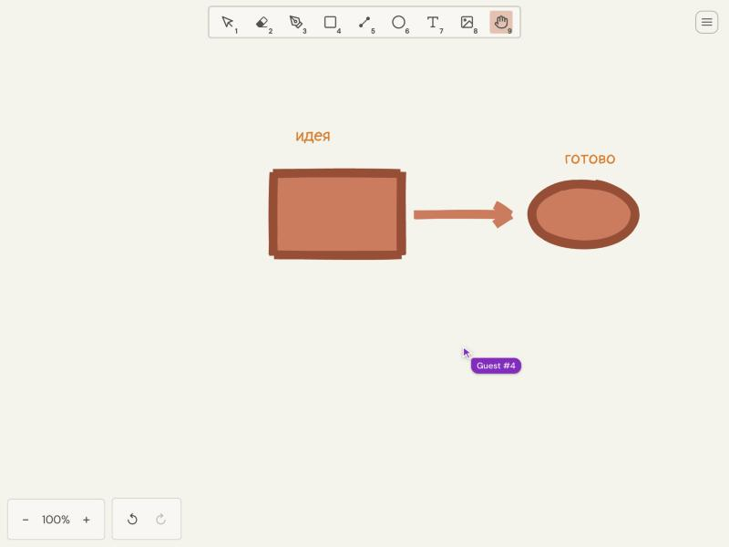

# ДроГА

Онлайн-доска, на которой рисуют вместе: создаёшь доску, кидаешь ссылку, и все видят рисунок и курсоры друг друга в реальном времени. Регистрация не нужна.

**Демо:** https://150.241.79.212.sslip.io



## Что умеет

- Карандаш, линии, прямоугольники, эллипсы, текст и картинки; рисунок в стиле «от руки» (roughjs).
- Курсоры участников с именами; чужой рисунок виден, пока его ещё рисуют.
- Выделение кликом и рамкой, перетаскивание и ресайз группы, удаление.
- Отмена и повтор (Ctrl+Z, Ctrl+Shift+Z или Ctrl+Y) с синхронизацией у всех.
- Масштаб и перемещение по доске: пробел, средняя кнопка мыши или инструмент «Рука».
- Доска сохраняется на сервере, вернуться можно по той же ссылке.
- При обрыве связи клиент сам переподключается и загружает доску заново.
- Регистрация и вход, лимит попыток входа.

## Как устроена синхронизация

Сервер ничего не знает про фигуры: он хранит доску как **историю сообщений** и пересылает каждое сообщение остальным участникам. Новый участник получает всю историю и восстанавливает по ней доску.

```
клиент A ──drawObj──▶ сервер ──drawObj──▶ клиенты B, C
                        │
                        └─ история доски ──▶ saves/<id>.board (когда уходит последний)
```

Сообщения по WebSocket `/draw/ws?id=<доска>`, части разделены `:::`:

| Команда   | Что делает                                                     | В истории |
|-----------|----------------------------------------------------------------|-----------|
| `drawObj` | готовый объект (JSON)                                          | да        |
| `delete`  | удалить объект; сервер вычищает из истории всё с этим `objId`  | —         |
| `temp`    | черновик: фигура, которую ещё рисуют или тащат                 | нет       |
| `cur`     | позиция и имя курсора                                          | нет       |
| `clear`   | очистить доску                                                 | —         |

Решения, которые из этого следуют:

- **Перемещение и ресайз** — это `delete` + `drawObj` с тем же `objId`, поэтому серверу не понадобилась отдельная команда. Пока объект тащат, остальным уходят `temp`-черновики, и у них оригинал прячется, а рисуется черновик.
- **Undo при нескольких участниках.** Журнал отмены свой у каждого клиента и хранит только его действия. Отмена превращается в обратные сообщения: отмена рисования — `delete`, отмена стирания — снова `drawObj`. Чужие действия своим Ctrl+Z не отменить.
- **Конфликты** решает порядок сообщений на сервере: кто последний, тот и прав. CRDT сознательно не делал — для доски, где каждый обычно рисует своё, этого хватает.
- **Переподключение.** Пока связи нет, доска закрыта плашкой: правки офлайн всё равно потерялись бы. После возврата связи доска очищается и заново собирается из истории сервера.

## Стек

**Фронтенд** (`frontend/src`): Vue 3 (`<script setup>`), TypeScript, Pinia, vue-router, VueUse, Nuxt UI, Tailwind, Vite. Рисование — Canvas 2D, roughjs (фигуры) и perfect-freehand (карандаш). Тесты — Vitest и @vue/test-utils.

**Бэкенд** (`backend`): ASP.NET Core на .NET 10, WebSocket, cookie-аутентификация, EF Core и SQLite (пользователи), доски — файлы в `saves/`. Тесты — xUnit (`Drawga.Tests`).

**Инфраструктура:** Docker, GitHub Actions, образ в GHCR, VPS с Caddy (HTTPS). Подробности — [deploy/README.md](deploy/README.md).

## Запуск локально

Нужны .NET SDK 10, Node 26 и pnpm.

```bash
cd frontend
pnpm install
pnpm dev
```

```bash
mkdir -p backend/dist
cd backend
ASPNETCORE_ENVIRONMENT=Development ASPNETCORE_URLS=http://localhost:5240 dotnet run --no-launch-profile
```

Открыть http://localhost:5240 — в режиме разработки бэкенд проксирует фронтенд с Vite (5173).

## Тесты

```bash
cd frontend
pnpm type-check
pnpm vitest run
```

```bash
dotnet test Drawga.Tests
```

## Деплой

Push в ветку `test-server` → тесты → Docker-образ в GHCR → на сервере `docker compose pull && up -d`. Настройка сервера и секретов — в [deploy/README.md](deploy/README.md).
